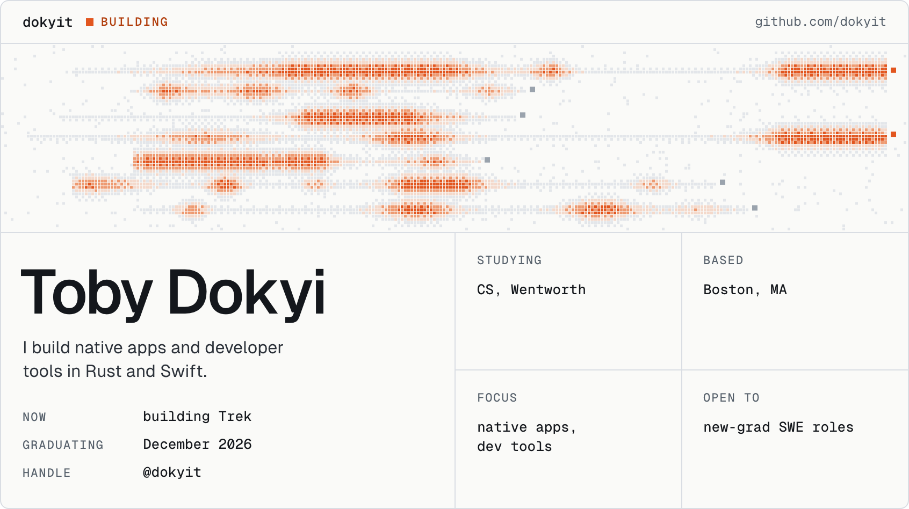
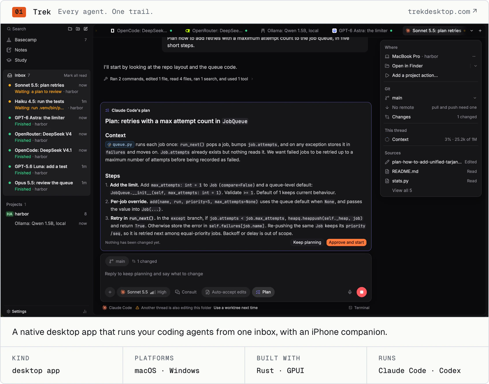
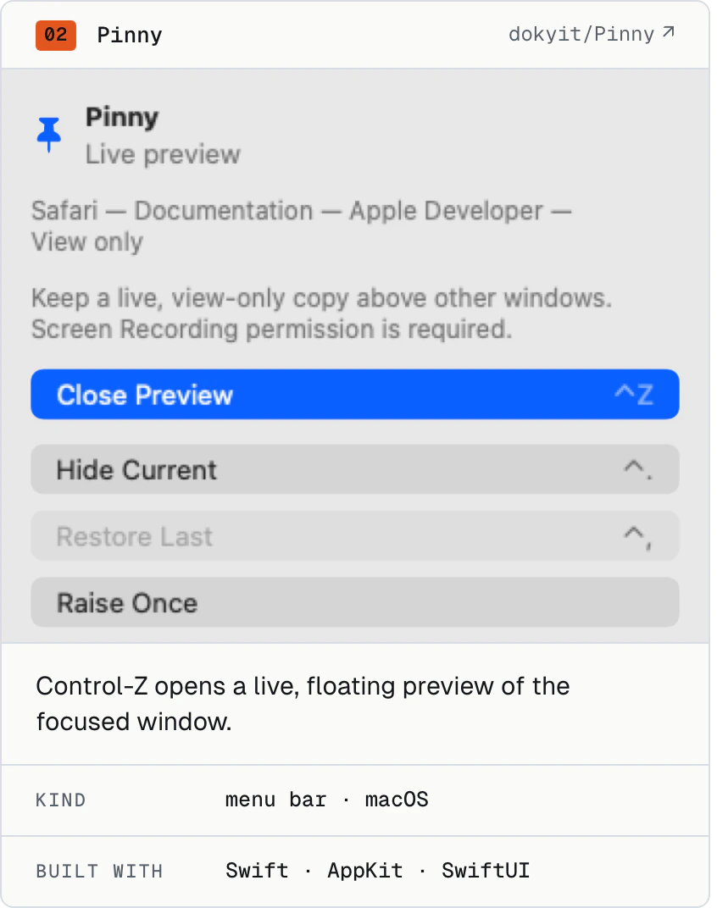
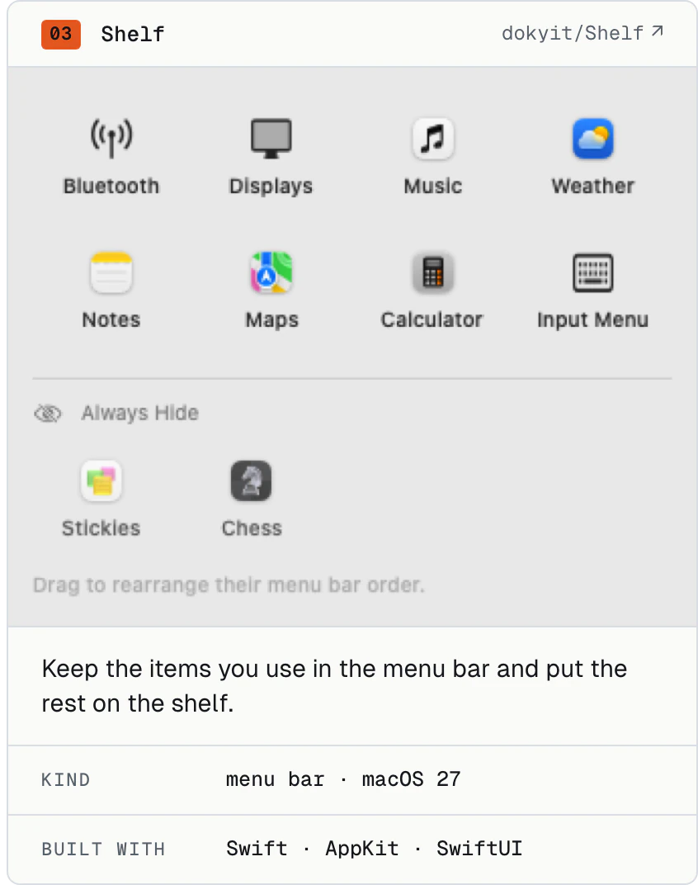
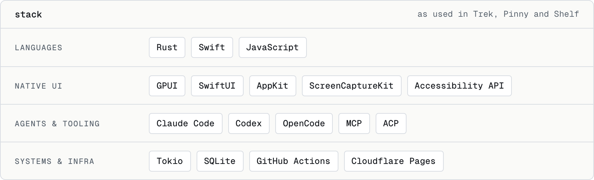
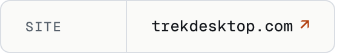

<!-- Every image below is built by src/build.mjs from src/blocks.html. On a phone (up to 600 px wide) each block switches to its stacked dark version. -->

<picture><source media="(max-width: 600px)" srcset="https://raw.githubusercontent.com/dokyit/dokyit/main/assets/header-phone.webp"><source media="(prefers-color-scheme: dark)" srcset="https://raw.githubusercontent.com/dokyit/dokyit/main/assets/header-dark.webp"></picture>

<a href="https://trekdesktop.com"><picture><source media="(max-width: 600px)" srcset="https://raw.githubusercontent.com/dokyit/dokyit/main/assets/trek-phone.webp"><source media="(prefers-color-scheme: dark)" srcset="https://raw.githubusercontent.com/dokyit/dokyit/main/assets/trek-dark.webp"></picture></a>

<a href="https://github.com/dokyit/Pinny"><picture><source media="(max-width: 600px)" srcset="https://raw.githubusercontent.com/dokyit/dokyit/main/assets/pinny-phone.webp"><source media="(prefers-color-scheme: dark)" srcset="https://raw.githubusercontent.com/dokyit/dokyit/main/assets/pinny-dark.webp"></picture></a><a href="https://github.com/dokyit/Shelf"><picture><source media="(max-width: 600px)" srcset="https://raw.githubusercontent.com/dokyit/dokyit/main/assets/shelf-phone.webp"><source media="(prefers-color-scheme: dark)" srcset="https://raw.githubusercontent.com/dokyit/dokyit/main/assets/shelf-dark.webp"></picture></a>

<picture><source media="(max-width: 600px)" srcset="https://raw.githubusercontent.com/dokyit/dokyit/main/assets/stack-phone.webp"><source media="(prefers-color-scheme: dark)" srcset="https://raw.githubusercontent.com/dokyit/dokyit/main/assets/stack-dark.webp"></picture>

<a href="https://trekdesktop.com"><picture><source media="(max-width: 600px)" srcset="https://raw.githubusercontent.com/dokyit/dokyit/main/assets/link-site-phone.webp"><source media="(prefers-color-scheme: dark)" srcset="https://raw.githubusercontent.com/dokyit/dokyit/main/assets/link-site-dark.webp"></picture></a><a href="https://www.linkedin.com/in/toby-dokyi"><picture><source media="(max-width: 600px)" srcset="https://raw.githubusercontent.com/dokyit/dokyit/main/assets/link-linkedin-phone.webp"><source media="(prefers-color-scheme: dark)" srcset="https://raw.githubusercontent.com/dokyit/dokyit/main/assets/link-linkedin-dark.webp"></picture></a><a href="https://github.com/dokyit"><picture><source media="(max-width: 600px)" srcset="https://raw.githubusercontent.com/dokyit/dokyit/main/assets/link-github-phone.webp"><source media="(prefers-color-scheme: dark)" srcset="https://raw.githubusercontent.com/dokyit/dokyit/main/assets/link-github-dark.webp"></picture></a>

